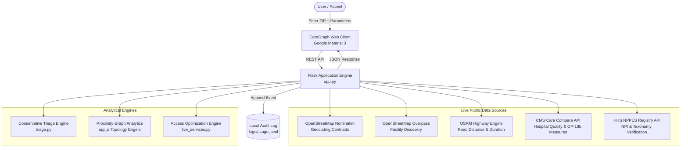

# CareGraph: Healthcare Intelligence Powered by Graph Analytics

[](https://www.python.org/)
[](https://flask.palletsprojects.com/)
[](https://m3.material.io/)
[](https://data.cms.gov/)
[](LICENSE)

**CareGraph** is an open-source healthcare intelligence and proximity graph analytics platform. Built with a clean, responsive **Google Material Design 3** interface, CareGraph performs real-time facility discovery, conservative clinical triage routing, and topological proximity graph analysis across hospitals and urgent care centers.

Unlike systems that rely on static, outdated facility directories or opaque claims, CareGraph evaluates real-time geographic road travel and pairs it directly with live, verifiable federal data from the **Centers for Medicare & Medicaid Services (CMS)** and **NPPES National Provider Identifier Registry**.

---

## Key Capabilities

- **Google-Grade Interface**: Designed following Google Health / Material Design 3 guidelines with Google Sans typography, quick-select ZIP chips, interactive mode selectors (Drive, Walk, Cycle), and dynamic range sliders.
- **Topological Proximity Graph**: Computes on-demand spatial networks connecting healthcare facilities using minimum-spanning Euclidean and highway vectors, reporting network density, interconnection counts, and optimal ingress hubs.
- **Conservative Triage Guidance**: Rule-based triage system that prioritizes patient safety by identifying potential emergencies (chest pain, stroke signs, severe trauma) and routing to appropriate emergency departments while filtering out low-acuity facilities.
- **Regional Access Recommender**: Multi-criteria decision engine evaluating regional facilities across the Tri-State area (NJ, NY, PA) using the empirical formulation:
  $$\text{Access Score} = 0.65 \times \text{Highway Travel Minutes} + 0.35 \times \text{CMS Historical ED OP-18b Minutes}$$
- **Live Official Registry Verification**: Deep-links to CMS Care Compare star quality ratings and HHS NPPES NPI registration records without caching assumptions.
- **Privacy-Preserving Audit Trail**: Local, user-inspectable JSON-lines audit log tracking high-level query metadata without capturing patient names, IP addresses, or clinical free-text.

---

## System Architecture



---

## Directory Structure

```text
CareGraph-Healthcare-intelligence-powered-by-graph-analytics/
├── app.py                         # Main Flask application and route handlers
├── live_services.py               # Live public source integrations (OSM, OSRM, CMS, NPPES)
├── triage.py                      # Conservative non-diagnostic triage guidelines
├── requirements.txt               # Python package dependencies
├── .gitignore                     # Git ignore rules for Python, logs, and environments
├── README.md                      # Comprehensive project documentation
├── logs/
│   └── usage.jsonl                # Local privacy-preserving query audit log
├── static/
│   ├── app.js                     # Frontend interactive controller & graph analytics
│   └── style.css                  # Google Material 3 stylesheet
└── templates/
    ├── base.html                  # Master Google-themed shell & top navigation
    ├── navigator.html             # Find Care & Proximity Graph Analytics view
    ├── care_guide.html            # Conservative symptom triage & routing view
    ├── recommender.html           # Regional hospital access recommender view
    ├── facility.html              # Official CMS & NPPES facility profile view
    ├── logs.html                  # On-device query telemetry audit trail
    └── sources.html               # Public sources, methodology limits & transparency
```

---

## Getting Started

### Prerequisites

- Python 3.10, 3.11, 3.12, or 3.13
- Internet access (to query live OSM, OSRM, and CMS APIs)

### Installation

1. **Clone the repository**:
   ```bash
   git clone https://github.com/<your-username>/CareGraph-Healthcare-intelligence-powered-by-graph-analytics.git
   cd CareGraph-Healthcare-intelligence-powered-by-graph-analytics
   ```

2. **Create and activate a virtual environment**:
   - **Windows (PowerShell)**:
     ```powershell
     python -m venv .venv
     .\.venv\Scripts\Activate.ps1
     ```
   - **Linux / macOS**:
     ```bash
     python3 -m venv .venv
     source .venv/bin/activate
     ```

3. **Install dependencies**:
   ```bash
   pip install -r requirements.txt
   ```

4. **Launch the application**:
   ```bash
   python app.py
   ```

5. **Open in your browser**:
   Navigate to [http://127.0.0.1:5055](http://127.0.0.1:5055)

---

## API Reference

| Endpoint | Method | Description |
| :--- | :--- | :--- |
| `/api/discover` | `POST` | Discovers nearby hospitals and urgent care within a radius; computes OSRM driving routes. |
| `/api/care-guide` | `POST` | Evaluates symptom inputs against conservative triage guidelines and returns filtered facilities. |
| `/api/recommend` | `POST` | Computes regional hospital rankings weighted by live highway travel and CMS OP-18b throughput. |
| `/api/facility-detail` | `POST` | Retrieves official CMS hospital rating, emergency service capabilities, and NPPES NPI metadata. |

---

## Public Data Transparency & Limitations

- **No Live Wait-Time Guarantees**: Public feeds do not broadcast live hospital emergency-department queues or ICU bed counts.
- **Emergency Situations**: For severe chest pain, stroke signs, difficulty breathing, or severe trauma, individuals must call **911** immediately.
- **On-Demand Queries**: Search results are fetched dynamically at runtime and are not stored in any centralized or commercial database.

---

## License

This project is licensed under the MIT License — see the [LICENSE](LICENSE) file for details.
